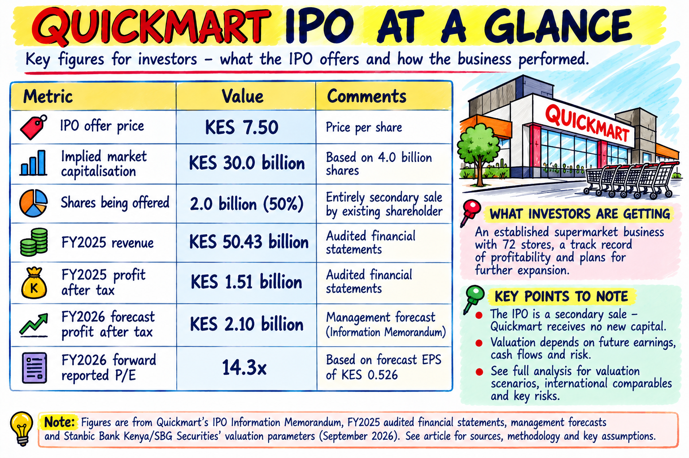
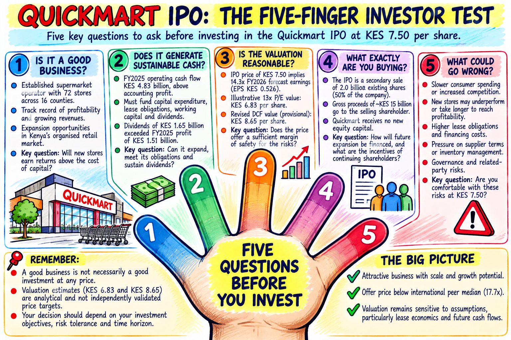
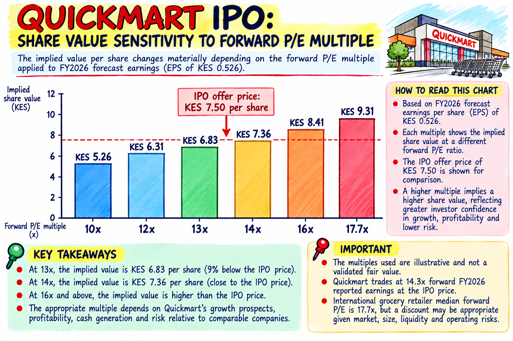
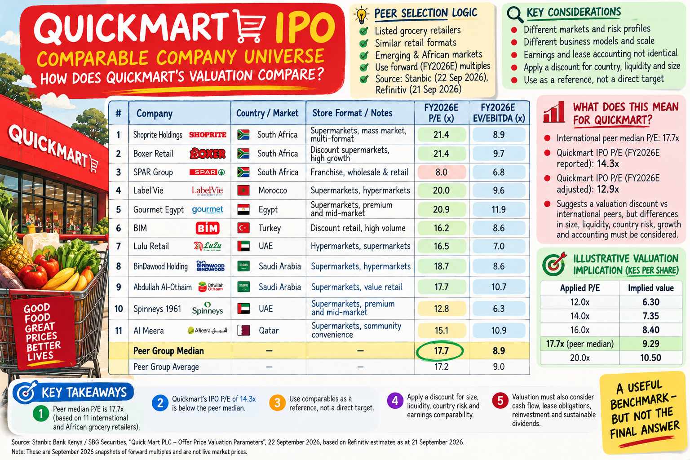
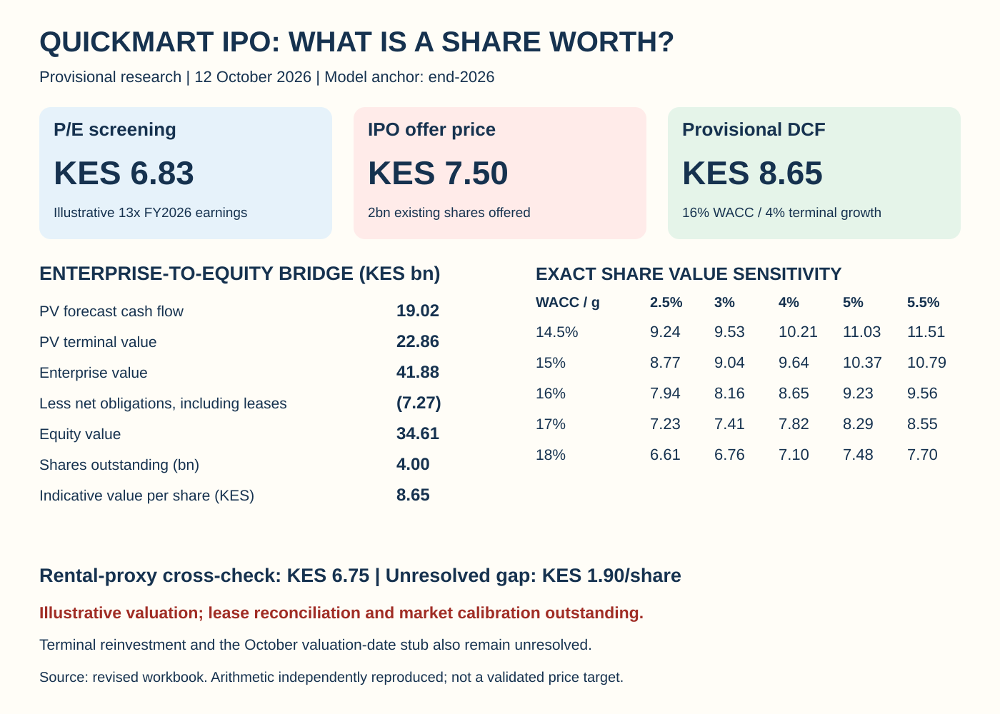

# Quickmart IPO: What Is a Share Really Worth at KES 7.50?

**An independent investor's guide to earnings, cash flows, international comparisons and the margin of safety.**

*Kenneth S. Legesi, CFA | Legesi Investment Research | 12 October 2026*

## The investment case in five minutes

Quickmart's IPO offers exposure to an established Kenyan supermarket business. The offer price of **KES 7.50 per share** implies a **KES 30bn equity valuation**. The issue for investors is whether that price adequately compensates them for the risks and future cash flows they acquire.

The IPO documentation reports FY2025 revenue of approximately KES 50.43bn and profit after tax of KES 1.51bn. Management forecasts FY2026 net profit of approximately KES 2.10bn. The offer comprises 2bn existing shares, or 50% of the company's issued capital; Quickmart receives no new equity capital from the sale.

Our assessment remains **WATCH / DEFER at KES 7.50**, pending validation of the cash-flow model and lease economics. The revised DCF suggests potential upside, but the evidence does not yet establish a dependable margin of safety.

This is a free-access assessment. All methods and limitations below are part of the investment reasoning.

## 1. Is it a good business?

Quickmart's reported 72-store footprint provides scale in organised grocery retail. Its investment case depends on procurement, inventory discipline, occupancy costs, customer demand and location-level profitability.

Customers generally pay promptly while suppliers provide payment terms. That can support cash generation, but expansion requires fit-outs, equipment, inventory and time for new stores to mature.

Store growth creates shareholder value when incremental returns exceed the cost of capital. Investors should monitor same-store sales, margins, store payback, inventory turnover and returns on invested capital rather than relying on store counts alone.

## 2. Do profits translate into sustainable cash?

FY2025 reported operating cash flow after tax was approximately KES 4.83bn. It exceeded reported profit, but cash available to shareholders also depends on capital investment, lease payments, financing flows and working capital.

An illustrative subtotal is **KES 4.83bn operating cash flow − KES 1.09bn PPE expenditure − KES 1.61bn lease principal = KES 2.13bn**. This is not a fully reconciled FCFF or FCFE measure; the classification of interest and other financing flows still matters.

Dividends of approximately KES 1.65bn exceeded FY2025 reported earnings of KES 1.51bn. That is not automatically unsustainable because reserves and existing cash can support distributions. It makes the balance between growth, distributions and liquidity an important diligence question.

## 3. Is KES 7.50 a reasonable price?

Management's FY2026 forecast PAT is KES 2.103bn. Dividing by 4bn shares gives **KES 0.52575 forecast EPS**. The IPO price is therefore approximately **14.3x forecast reported earnings**.

Our earlier earnings screen applied an illustrative 13x multiple, giving **KES 6.83 per share**, approximately 9% below the offer price. The multiple is a judgmental assumption, not an empirically derived fair-value adjustment.

| Applied forward P/E | Implied KES/share |
|---|---:|
| 10x | 5.26 |
| 12x | 6.31 |
| 13x | 6.83 |
| 14x | 7.36 |
| 16x | 8.41 |
| 17.7x | 9.31 |

### International comparisons

Stanbic's September 2026 valuation parameters report a median FY2026E P/E of **17.7x** and EV/EBITDA of **8.9x** in an eleven-company grocery sample. The estimates are dated 21 September 2026, rather than live market valuations.

The universe spans Africa, Turkey and the Gulf. Business formats, scale, liquidity, country risk and lease accounting vary materially. Quickmart's 14.3x reported forward P/E is below the headline median, but that difference alone does not prove undervaluation.

Applying 17.7x directly gives KES 9.31 per share; applying an illustrative 20% discount gives KES 7.44. The discount is a sensitivity, not an independently established risk adjustment.

*Source: Stanbic Bank Kenya/SBG Securities, printed page 3, Refinitiv estimates dated 21 September 2026. The illustration's side-panel calculations use rounded PAT of KES 2.10bn; this article uses KES 2.103bn.*

## 4. What does the enterprise DCF suggest?

The revised working model starts with management's FY2027 forecast and extends analyst assumptions through FY2032. It uses a provisional **16% nominal KES WACC** and **4% terminal growth**. It is anchored to **end-2026**, not precisely the publication date.

| Component | KES bn |
|---|---:|
| PV FY2027–2032 cash flows | 19.02 |
| PV terminal value | 22.86 |
| **Enterprise value** | **41.88** |
| Less net financial obligations including leases | (7.27) |
| **Equity value** | **34.61** |
| Shares outstanding | 4.00bn |
| **Provisional value per share** | **KES 8.65** |

The arithmetic implies approximately **15.4% upside** to the offer. It has been reproduced from the workbook's numeric inputs, but this does not validate the economic assumptions.

Approximately 55% of EV comes from terminal value. The discount rate lacks a completed market build, FY2027 working-capital outflow is a zero placeholder, and terminal reinvestment is not explicitly linked to sustainable ROIC.

### The lease question

Lease liabilities are approximately KES 7.9bn in the model's source disclosures. Net obligations of KES 7.27bn differ from gross lease liabilities because debt and cash must also be considered.

The rental-based cross-check gives **KES 6.75 per share**, leaving a material **KES 1.90 gap** to the enterprise DCF. Its KES 2.05bn FY2027 rental input is unverified, and future lease additions, renewals and liabilities are not fully matched in either approach.

The rental result is not a validated lower valuation bound. The cash-flow conventions and capital structure need reconciliation before KES 8.65 can be treated as a price target.

## 5. Who receives the subscription proceeds?

Sokoni Retail Kenya Limited is selling 2bn existing shares. Full subscription at KES 7.50 implies **KES 15bn gross proceeds for the selling shareholder**. Quickmart receives no new equity capital.

A secondary sale can broaden ownership and create liquidity. Future expansion must nevertheless be financed by company cash generation or other funding sources, rather than IPO proceeds.

The disclosed two-year lock-up applies to **60% of the seller's retained shares**, not the entire retained holding. Read the full offer restrictions and exemptions when assessing future selling pressure.

## Investment conclusion

| Reference | KES/share | Status |
|---|---:|---|
| Earnings screen | 6.83 | Illustrative 13x FY2026 P/E |
| Offer price | 7.50 | Transaction term |
| Enterprise DCF | 8.65 | Provisional 16% / 4% model |
| Rental cross-check | 6.75 | Unreconciled proxy |

These indications should not be averaged into a target: their methods and evidential support differ.

**WATCH / DEFER** remains the assessment. Stronger evidence on sustainable cash generation, store-level returns, lease economics and capital allocation would support reconsideration. Weak new-store returns, stretched supplier credit, margin pressure or distributions that constrain investment would weaken the case.

This is not a prediction that the shares will fall after listing. It describes the evidence needed for a disciplined investment decision.

## Which stock should we assess next?

Which listed company or upcoming IPO would you like assessed next? Share the company, ticker and exchange, together with the question you most want answered: valuation, dividends, financial strength, growth or governance.

Share this assessment with another investor and subscribe to [Legesi](https://legesi.substack.com/) for future research and Five-Finger Investor Guides.

## Sources and methodology

See the [official document links and page references](../sources/official-document-links.md), [valuation methodology](valuation-methodology.md), [limitations](../valuation/assumptions-and-limitations.md), and [reproduction script](../scripts/reproduce_valuation.py). Historical information and management forecasts are distinct from analyst assumptions. Packaging reproduced model arithmetic; it did not complete a financial audit or market calibration.

*For investor education and general information. Not personalised investment advice, an offer or solicitation, or a guarantee of performance. Read the [full disclaimer](../DISCLAIMER.md).*
